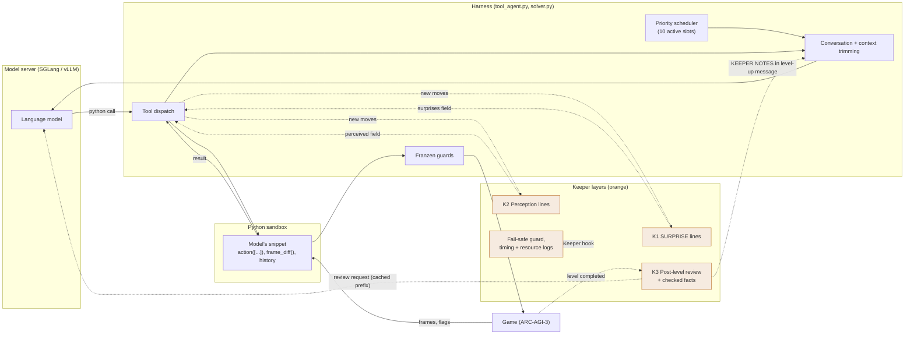
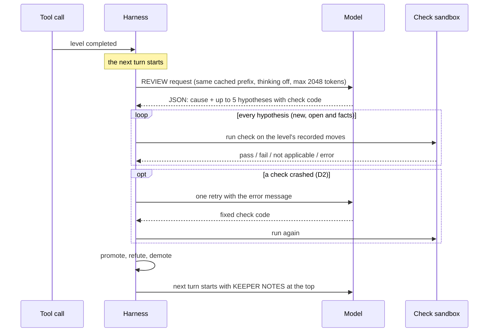
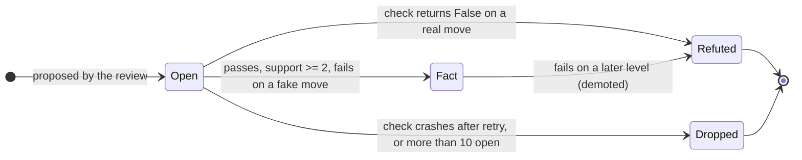

# The Keeper Project: Full Report

*Status as of 22 October 2026. Branch `keeper-v3`. Written so you can understand the project and explain it to the team.*

## How to read this report

Every claim in this report carries one of four labels. Please keep them when you repeat a claim to others.

| Label | Meaning |
| --- | --- |
| **[MEASURED]** | A number or fact read directly from a file, log, git commit or Kaggle page. The source is named. |
| **[FROM COMMIT]** | A statement taken from a git commit message. It is what we wrote at the time. I did not re-verify it. |
| **[INTERPRETATION]** | Our explanation of why something happened. It may be wrong. |
| **[UNKNOWN]** | We do not have the evidence. |

Every technical term is explained the first time it appears, and again in the [glossary](#9-glossary).

This report was written without changing any code and without running any game. Some numbers were recomputed from saved run files (benchmark files, Keeper fact files, timing logs). The unit tests were counted, not run.

---

## Contents

1. [The big picture](#1-the-big-picture)
2. [Every Keeper layer](#2-every-keeper-layer)
3. [Timeline](#3-timeline-what-we-did-and-why)
4. [Experiments and results](#4-experiments-and-results)
5. [What went wrong and what we learned](#5-what-went-wrong-and-what-we-learned)
6. [How to run everything](#6-how-to-run-everything)
7. [Code map](#7-code-map)
8. [Open questions and next steps](#8-open-questions-and-next-steps)
9. [Glossary](#9-glossary)
10. [Appendix: where the numbers come from](#10-appendix-where-the-numbers-come-from)

---

## In five sentences

1. ARC-AGI-3 is a benchmark of small interactive puzzle games. An agent gets no instructions and must work out the rules by playing.
2. Our agent is a language model that plays through a Python tool. The harness around it (Tufa Labs' "Duck", improved by Daniel Franzen) handles the model server, the scheduling, the context and the game.
3. **Keeper** is what we added on top. It builds short, checked feedback from the agent's own recorded moves and puts it in front of the model.
4. Keeper has gone through three generations (v1 on the Duck, v2 on the Duck, v3 on Franzen's harness). Only the ideas that survived are in v3: SURPRISE lines, perception lines, and a post-level review whose rules are checked by code.
5. **The honest result so far:** on the 25 demo games, Keeper is not measurably different from the baseline (mean score 47.7 for the baseline, 46.2 for Keeper D, 44.2 for Keeper D2; no difference is statistically significant). On the hidden competition set, the baseline scored 28.74 and Keeper D scored 0.00. We do not yet know why D scored 0.00.

---

## 1. The big picture

### 1.1 What ARC-AGI-3 is

ARC-AGI-3 is the third benchmark in the ARC Prize family. Each task is an **interactive game**:

- The game is a 64 × 64 grid of cells. Each cell has one of 16 colors.
- The agent sees the grid. It can press `UP`, `DOWN`, `LEFT`, `RIGHT`, `SPACE`, click a cell with `MOUSE(row, col)`, `UNDO`, or `RESET`. Which of these exist depends on the game.
- **Nobody tells the agent the rules or the goal.** It has to find out by experimenting.
- A game has several levels (6 to 10 in the public set). Completing a level shows the next one. Levels usually reuse earlier mechanics and add new ones.
- A level can end in **game over** (the agent died or a step budget ran out). The level then restarts and the completed levels are kept.
- The games are deterministic: the same moves from the same state give the same result.

There are two sets of games:

| Set | Size | Used for |
| --- | --- | --- |
| Public demo set | 25 games | Our own experiments. We can run them as often as we like. |
| Hidden competition set | about 110 games (the notebook says "game count should be 110") | The leaderboard score. It runs on Kaggle with no internet, once per game. |

### 1.2 How scoring works

The ARC Prize calls the score family **RHAE (Relative Human Action Efficiency)**. The idea: finishing a level is not enough. You are compared with a human baseline for how many actions you needed. The name RHAE comes from the ARC Prize; the exact formula below is copied from our own code.

**[MEASURED]** Source: `GameRun._compute_final_score` in `tufa-arc-agi-framework/src/taaf/game.py`, which says it mirrors the official `arc_agi.scorecard.EnvironmentScoreCalculator` (v0.9.8).

For each level in a game:

```
level_score = min(115, (baseline_actions / agent_actions)² × 100)    if the level was completed
level_score = 0                                                       otherwise
```

- `baseline_actions` is the number of actions a human baseline needed for that level.
- `agent_actions` is how many actions the agent spent on that level.
- The ratio is **squared**, so using twice the baseline actions gives only 25 points, not 50.
- A level score is capped at 115.

Level scores are combined with **weights equal to the level number** (level 1 has weight 1, level 2 has weight 2, and so on):

```
game_score = sum(level_score × weight) / sum(weights)
game_score is capped at (sum of weights of levels with score > 0) / sum(weights) × 100
```

Worked example. A game has 3 levels with human baselines of 20, 30 and 40 actions. The agent completes level 1 in 40 actions, level 2 in 30 actions, and never completes level 3.

| Level | Weight | Calculation | Level score |
| --- | --- | --- | --- |
| 1 | 1 | (20 / 40)² × 100 | 25 |
| 2 | 2 | (30 / 30)² × 100 | 100 |
| 3 | 3 | not completed | 0 |

Game score = (25 × 1 + 100 × 2 + 0 × 3) / (1 + 2 + 3) = 225 / 6 = **37.5**. The cap is (1 + 2) / 6 × 100 = 50, so 37.5 stands.

What this means in practice:

- **Later levels are worth more.** Reaching level 6 matters much more than perfecting level 1.
- **Wasted actions cost points.** Pressing keys to explore lowers the score, because the squared ratio drops fast. This is why guards that stop wasted actions exist.
- **Not finishing a level gives zero for that level.** A game where the agent finishes nothing scores 0.
- The leaderboard score is the average over all hidden games.

### 1.3 The starting point: Tufa Labs' Duck harness

A **harness** is the program around the language model. It starts the games, builds the messages the model reads, runs the tools the model calls, and records everything.

The Duck harness (Tufa Labs, winner of the first milestone prize) has one central idea: **the model plays through a Python tool.**

**[MEASURED]** Sources: the system prompt in `inference/agent/prompts.py`, and Franzen's `WRITEUP.md`.

How it works:

1. **A conversation per game.** The conversation holds a system prompt, then a growing list of user messages, model replies (including the model's reasoning), tool calls and tool results.
2. **One tool: `python`.** The model never presses a key directly. It writes a Python snippet (the "REPL" idea: read, evaluate, print).
3. **Pre-loaded variables.** Each snippet starts with a fresh namespace that already contains:
   - `current_frame` and `previous_frame`: the latest boards, with `.ascii` (the grid as colored letters), `.step`, `.level`, `.shape` and `.segmentation`.
   - `history` and `transitions`: every action taken and the board before and after it.
   - `valid_actions`, `last_action_call_result`.
4. **`action([...])`.** Inside the snippet the model calls `action(['RIGHT', 'RIGHT', 'UP'])` or `action([{'action': 'MOUSE', 'row': 12, 'col': 40}])`. The harness runs each action on the real game and refreshes the variables. One call can carry many actions (a **batch**).
5. **Segmentation.** `current_frame.segmentation` splits the board into **objects**: groups of same-colored cells that touch along an edge (4-connected). Each object has a color, a size, a shape hash (a signature that ignores position and rotation), containment and adjacency. The model is told to read the board through objects instead of staring at the raw grid.
6. **Eviction (context trimming).** A model can only read so much text at once (its **context window**). When the conversation grows past the limit, the harness drops the oldest messages right after the system prompt. This is called eviction. What the model learned in those messages is gone unless something saved it.
7. **A "world model" memory.** The original Duck asked the model to keep structured notes (labelled sections) that were re-inserted each turn.

### 1.4 Franzen's Milestone 2 solution

Daniel Franzen took the Duck and made it better under the competition's hardware limits. His public leaderboard score is **27.89** **[MEASURED]**, taken from his write-up.

What he changed and why, in plain words **[MEASURED]**, from `WRITEUP.md` and `ARC3-Inference/CONFIGURATION.md`:

| Area | Original Duck | Franzen | Why it matters |
| --- | --- | --- | --- |
| Model | Qwen3.6-27B | Qwen3.8-Flash-Next (4-bit, with a draft model for speculative decoding) on a patched SGLang server | Each model upgrade gave a large improvement in his tests. |
| Running games | A fixed number of games at a time, each with a fixed time limit | All games start together; 10 hold an active slot; a **priority scheduler** hands slots to the games with the best expected score gain | Time is not wasted on games that make no progress. |
| Context | Rough character-based size estimate; trims just enough each time | Calibrated token estimate; 128K window; when full, trims a large block down to about 58K | A small trim changes the start of the conversation every time and forces the server to re-read everything. One big trim keeps the **prefix cache** valid (the server remembers the start of the conversation). About 93% of prompt tokens were reused from cache. |
| Memory | Structured world model | World model switched off; the raw conversation is the memory | With a bigger window, the conversation already held the evidence. |
| What the model sees | Board image at 4× | 10× image, a difference image showing changed pixels, the fatal frame after game over, animation frames | The 10× scale was the single biggest image improvement. |
| Detecting change | Model writes its own diffs | `frame_diff()` helper: which objects moved, rotated, appeared, disappeared | Cheaper and more reliable than the model doing it by hand. |
| Actions | `ACTION7` listed but refused | `UNDO` enabled | Helps on some games. |
| Wasted moves | No guards | Guards stop a batch after an action changes nothing inside the board (ignoring a 4-cell border where timer bars sit) | Wasted actions lower the score. |
| Python helpers | Wiped every call | Functions the model defines are kept for the whole game | Saves tokens. |
| Prompts | "The game is over." | Detailed game-over diagnosis, level-transfer guidance | Stops long confused re-analysis. |

**The "about 28 versus about 1" gap.** Our first Keeper on the Duck (keeper-v2) scored **1.11** on the leaderboard. Franzen's harness scored 27.89 (his submission) and 28.74 (our rerun of it, run A). **[MEASURED]** for the three numbers.

*Why the gap is so large* is **[INTERPRETATION]**. The evidence points to speed and capacity, not to Keeper's ideas. In our Kaggle run of keeper-v2, all 25 games ran at once on one vLLM server. Each game produced only 15 to 18 thousand tokens and played between 1 and 123 actions, and every game was cancelled after about 37 minutes with 6 levels completed across all 25 games **[MEASURED]**, `keeper-runs/kaggle/v4-output`. Franzen's setup is built to keep one GPU busy with 10 well-cached games.

### 1.5 Where Keeper fits

Keeper is a set of optional layers. Each one watches the game record the harness already keeps, and adds a short piece of text to what the model reads. Every Keeper switch defaults to off. With all switches off, the code behaves exactly like Franzen's published configuration.



The three Keeper layers hook in at three different points:

| Layer | Hook point | Extra model request? |
| --- | --- | --- |
| K1 SURPRISE | After each tool call, on the new moves. Adds a `surprises` field to the tool result. | No |
| K2 Perception | Same place. Adds a `perceived` field. | No |
| K3 Review | When a tool call completes a level. Before the next model turn, one review request is made and the KEEPER NOTES block is put at the top of the level-up message. | Yes (one per level, one retry if a check crashed) |

---

## 2. Every Keeper layer

### 2.0 Overview: three generations

Keeper was not built in one go. The first two generations lived on the Duck. After the Duck scored 1.11 we moved the surviving ideas to Franzen's harness.

| Generation | Branch / repo | Dates | Where it lives |
| --- | --- | --- | --- |
| **v1** | `duck-layers` in `The_keeper_harness` | 18 Oct 2026 | `prediction.py`, `level_memory.py`, `layer_config.py` |
| **v2** | `keeper-v2` in `The_keeper_harness` | 19 to 20 Oct 2026 | Adds `auto_prediction.py`, `perception.py`; extends `level_memory.py` |
| **v3** | `keeper-v3` (a fork of Franzen's repo) | 20 to 22 Oct 2026 | `inference/agent/keeper_*.py` |

Fate of each layer:

| Layer | Introduced | In v3? | Short reason |
| --- | --- | --- | --- |
| `expect=` prediction check | v1 | **Dropped** | The model almost never used it. |
| Auto-prediction / SURPRISE | v2 | **Kept, changed** | Costs no model call. Rewritten and reworded. |
| `world_model()` / `plan()` and nudges | v2 | **Dropped** | Franzen found the structured world model hurts. The model often did not call it. |
| Post-level reviewer with check code | v1 (agent-written), v2 (reviewer-written) | **Kept, changed** | The core idea. Heavily reworked in v3. |
| Perception (transform, shape match, roles) | v2 | **Kept** | Offline cost is tiny. |
| Batch summary, early stop, RESET label, HUD mask ("Part 5") | v2 | **Partly dropped** | Franzen's guards cover the stop. The per-step batch summary is not in v3. |
| Fail-safe guard, incremental history, resource log, timing log | v3 | v3 only | Added after D's 0.00 and for D2's analysis. |

---

### 2.1 Layer 1 (v1): the `expect=` prediction check

**Problem it solves.** The Duck shows the model `board_changed` and the before/after frames. Nothing forces the model to say what it *thinks* a move will do. Without a committed prediction, the model rarely notices that its picture of the game is wrong.

**How it works, step by step.**

1. The model calls `action(['RIGHT'], expect={'moves': ..., 'board_changed': True})`. The allowed keys are `board_changed`, `level_completed`, `game_over`, `moves`, `appears`, `disappears`, `cells` and `note`.
2. The harness runs the action on the real game.
3. The harness (not the model) compares the expectation with the real before/after boards and result flags.
4. The tool result carries a verdict per action: `confirmed`, `wrong` (with a short diff of what differed) or `no_prediction`.
5. After a number of moves without `expect=`, a loud reminder is added to the user prompt (the "nudge", default after 5 moves).

**Files** (branch `keeper-v2` of `The_keeper_harness`): `inference/agent/prediction.py` (pure comparison), the `action(..., expect=...)` change in `python_tool_sandbox.py`, the verdict logic in `solver.py`, and `layer_config.py` for the switches.

**Config switches** (v1/v2 JSON config, `prediction_check` block): `enabled`, `max_wrong_diffs_shown` (5), `nudge_after_actions` (5), `auto_predict`, and others.

**What happened. Dropped.** **[MEASURED]** from the saved v1 and v2 lab runs (`keeper-runs/`):

| Run set | Actions | `expect=` verdicts | No prediction |
| --- | --- | --- | --- |
| v1, ls20, 1 run | 31 | 0 confirmed, 0 wrong | 29 of 29 checked moves |
| v2 lab runs "new" (4 runs: 3 ls20, 1 tn36) | 289 | 0 confirmed, 0 wrong | 216 |
| v2 lab "full" run (mostly failed to start; see 4.2) | 88 | 12 confirmed, 1 wrong | 53 |

In the runs that worked, the model used `expect=` on almost none of its moves. The only runs with any confirmed verdicts were the broken "full" run. **[INTERPRETATION]** A small model under a long task does not add optional syntax to its calls, even when reminded (the reminder events exist: 16 in one ls20 run). v3 therefore does not ask the model to predict anything. It predicts for the model (next section).

---

### 2.2 Layer 1b (v2, kept in v3): auto-prediction and SURPRISE lines

**Problem it solves.** The model often assumes an action does the same thing every time. When it does not (a wall blocks a move, a key now moves a different object), the change gets lost inside a long batch of actions or a long reasoning text.

**The idea.** The harness predicts, on its own, that each action will do the same thing it did the last time on this level. If it does something different, the tool result carries a `SURPRISE` line. If it behaves as before, nothing is added. This costs no model call.

**How it works, step by step (v3: `keeper_auto.py`).**

1. After a tool call, take each new move on the current level. Moves that are a `RESET` are skipped.
2. Find the most recent earlier use of the *exact same action text* on this level. A click only compares with a click on the **same cell**.
3. Describe both moves as an **effect**: which cells changed (ignoring a border of 4 cells where timer bars live), which objects moved and by how much, which objects appeared or disappeared, and whether the level was completed or the game was lost.
4. Report the differences. The kinds are:
   - `blocked` (changed the board last time, nothing now) and `unblocked`
   - `moved_differently` (same object, a different move)
   - `moved_newly` (moved now, stayed still last time)
   - `appeared` and `disappeared` (new this time)
   - `level_completed` or `game_over` caused for the first time
5. A **toggle** switching back (the action exactly undoes its own previous effect) is *not* a surprise. It is the normal alternation.
6. At most 3 lines per tool call, and one line per kind. (v2 allowed 5.)

**Real format** (taken from the D2 code, `keeper_auto.surprise_lines`):

```
SURPRISE: single LEFT at step 48 (action 3 of 12 in this call) vs the last single LEFT at step 41: it changed the board last time, nothing this time
```

**Real example from our runs** **[FROM COMMIT]**, commit `4c0cdf6`: before the per-step summary existed, a batch of 20 `LEFT` presses that hit a wall 15 times and then ran out of steps was reported only by its final state. The model read it as "LEFT moves the player down 30 rows". The wall hits and the automatic reset were invisible. This is the "20-LEFT batch with the reset" problem. See section 2.7 for what v2 did about it and what v3 does.

**Real example from our runs** **[FROM COMMIT]**, commit `0a58577`: on tn36, clicks on *different cells* were treated as a repeated action, so a "surprise" stopped them. All 6 batch stops in the matched run came from this, and the model fell back to one click per turn. The fix compares actions with their coordinates. Offline on 20 tn36 passes, the toggle rule cut the surprises from 936 to 51 (and removed all 6 wrong stop points); on ls20 all 43 surprises were kept.

**D2 wording change** **[FROM COMMIT]**, commit `4196b43`: the model was unsure whether a line compared single actions or whole batches (seen on cn04 and ka59). It always compared one action with the previous *single* use of the same action. Each line now says "single X at step N vs the last single X at step M".

**Files (v3).** `keeper_auto.py` (effects, toggle rule, `surprise_lines`), `keeper_history.py` (the per-game record of recent moves and a cache of effects), hook `_keeper_observe` in `tool_agent.py`, and the system-prompt sentence `KEEPER_SURPRISE_ADDENDUM` in `prompts.py`.

**Config.** `KEEPER_SURPRISE` (default off), `KEEPER_SURPRISE_MAX_LINES` (3), `ARC3_NOOP_GUARD_BORDER` (4; shared with Franzen's guards).

**Status.** Kept in v3 and active in runs D and D2.

**[UNKNOWN]** Whether SURPRISE lines help the model's score. Run C (SURPRISE only) was built but not run (see 4.5).

---

### 2.3 Layer 2 (v2): `world_model()` / `plan()` and nudges

**Problem it solves.** Every Python call starts with a fresh namespace, and old messages are evicted when the context fills. What the model learned on level 1 is often gone by level 3. v2 tried to give the model a place to write down what it understood.

**How it worked.**

1. The sandbox gained `world_model(text)` and `plan(text)`. The harness stored the text and re-inserted it every turn.
2. After 3 turns without a call, the user prompt carried a reminder (the **world-model nudge**).
3. If the model still did not call it, a fallback read the last block labelled "World model:" or "Plan:" from the model's reasoning text.
4. On a level change the world model was cleared, but a `LEARNED LAST LEVEL` block (the reviewer's cause sentence plus up to 3 untested ideas) stayed in context next to the pinned verified facts.

**Files** (`keeper-v2` branch): `level_memory.py`, `python_tool_sandbox.py`, `tool_agent.py`; config block `world_model` (`nudge_after_turns` 3, `reasoning_fallback` true).

**What happened. Dropped.**

- **[MEASURED]** In the two ls20 runs of the v2 lab set, the model made **0** `world_model()` calls after 24 nudges (9 + 15). In the tn36 run it made 32 calls. Source: `keeper-runs/new/*/artifacts/*events.jsonl`.
- **[FROM COMMIT]** Commit `8b46e42` added the reasoning fallback exactly because the model often did not call the function.
- **[INTERPRETATION]** The team's reading was that the model writes its world model inside its hidden thinking instead of calling the function, so the stored model stayed empty. I did not re-verify this claim; the zero-call counts above are consistent with it.
- **[MEASURED]** Franzen's own tests (`WRITEUP.md` section 6) found that turning the world-model mechanism off entirely worked best once the context window was large.

So in v3 there is no `world_model()` and no nudge. The idea of "keep what we learned across levels" survived in a different form: the KEEPER NOTES block (section 2.5).

---

### 2.4 Layer 3: the post-level review (hypotheses, check code, perturbation test, facts)

This is the core of Keeper. It is also the most complicated layer, so it gets the most space.

**Problem it solves.** When a level is cleared, the model has just learned something. That knowledge sits in long reasoning that will eventually be evicted, and it may be wrong. We want to keep only knowledge that the recorded moves actually support, and carry it to the next level.

**The principle: the model never promotes a rule by opinion. Only code can.** The model proposes. The harness checks. Only rules that pass become **facts**.

#### Terms used here

| Term | Meaning |
| --- | --- |
| **Hypothesis** | A rule or goal the model believes, in one sentence, plus a small Python function that can test it. |
| **Check code** | The function `check_transition(t)`. It looks at one recorded move `t` and returns `False` if the move breaks the rule, `True` if the move obeys it, and `None` if the rule does not apply to that move. |
| **Support** | How many recorded moves returned `True`. |
| **Fact** | A hypothesis that passed all the tests below. |

#### How it works, step by step (v3: `keeper_review.py`, `keeper_check_sandbox.py`, `_keeper_review` in `tool_agent.py`)



1. **Trigger.** A tool call completes a level. (Game overs only trigger a review if `KEEPER_REVIEW_ON_GAME_OVER` is on; it is off.) The review is skipped in the last 20% of the scheduled runtime, or when less than 240 seconds remain, and the skip is logged.
2. **Request.** One extra request is sent on **the game's own cached prefix**: the same system prompt, history and tools as the game's next request, plus a short review message. Because it continues the cached prefix, it does not force the server to re-read the conversation. Thinking is off, and the answer is limited to 2,048 tokens. The exchange is not stored in the game's history. Its tokens do not count toward the turn's yield budget or toward the level's tokens in the priority formula.
3. **The review message** lists the level's moves in merged form (runs of the same action with the same effect become one line, the last 60 groups), the facts already verified, and the check API. It asks for (a) a one-sentence **cause** (what finally completed the level and which earlier events it needed) and (b) up to 5 hypotheses.
4. **Parsing.** The reply is JSON. If the reply was cut off by the token limit, the cause and every complete hypothesis are still kept.
5. **Mechanical check.** Each hypothesis's check code runs in a **separate, restricted subprocess** (`python -I -S`, an import allowlist, CPU and file limits, a 10-second timeout) over every recorded move of the level. One `False` means the rule is **refuted**. No `True` at all means the rule says nothing yet.
6. **Perturbation (falsifiability) test.** A rule that is `True` on every move might be empty ("something happens"). So the harness also runs the check on **fake moves** it builds from the real ones:

   | Fake move | How it is built |
   | --- | --- |
   | `crossed` | The move's action with the *outcome of a different move*. |
   | `frozen` | The board did not change and the level was not completed. |
   | `swapped` | A different action name. |
   | `flipped` | The result flags inverted. |

   A rule is **falsifiable** only if it returns a clean `False` on at least one fake move. A crash on a fake move does not count as a rejection.
7. **Promotion.** A hypothesis becomes a **fact** only if it (a) passed on the real moves, (b) has **support of at least 2** moves (summed across levels; `KEEPER_FACTS_MIN_SUPPORT`), and (c) was falsifiable.
8. **Re-checking and demotion.** Facts and open hypotheses are re-checked on every later reviewed level. A fact that fails there is **demoted** (its status becomes `refuted`). This matters: a rule that held on level 2 may not hold on level 5.
9. **Cap.** At most 10 open hypotheses are kept (`KEEPER_REVIEW_MAX_OPEN`). The rest are dropped.
10. **Retry (D2).** If a check crashes, the model is asked once more, on the same conversation, with the error and its code. A check that still cannot run stays dropped.



#### The check API (what the model's check code may use)

Written out in the review request (`CHECK_API` in `keeper_review.py`), with two worked examples that the unit tests execute. In summary: `t.action`, `t.level`, `t.step`, `t.before_frame` and `t.after_frame` (each with `.ascii`, `.level`, `.step`, `.segmentation`), `t.result` (with `level_completed`, `game_over`, `board_changed`), helpers `cell(frame, row, col)`, `changed_cells(before, after)` and `parse_action(text)`; `re`, `math`, `collections` and `itertools` are pre-imported; at most 12 lines.

#### Real examples of facts **[MEASURED]**

From the saved `*_keeper_facts.json` of run D (game ar25):

> "A black piece only responds to arrow keys while it carries the white dots; each press translates it exactly 3 cells and its shape never rotates or flips." (support 130, held on levels 4, 5, 6, 7)
>
> "SPACE does not move anything: it transfers arrow-key control (the white dots) to the next object in a cycle mirror -> piece1 -> piece2 -> mirror." (support 18, levels 4 to 7)

**[INTERPRETATION]** These are correct, useful rules about ar25. Whether giving them to the model changes its score is **[UNKNOWN]**.

**Files (v3).**

| File | Role |
| --- | --- |
| `keeper_review.py` | Review prompt, reply parsing, hypothesis memory (`KeeperMemory`), promotion and demotion, the notes block |
| `keeper_check_sandbox.py` | The restricted subprocess that runs check code, and the fake-move tests |
| `tool_agent.py` | `_keeper_review` (makes the requests), `_keeper_before_turn` (decides when and puts notes in the message), `_keeper_memory_for` |
| `prompts.py` | `KEEPER_REVIEW_ADDENDUM`: one fixed sentence in the system prompt |

**Config switches.**

| Variable | Default | Meaning |
| --- | --- | --- |
| `KEEPER_REVIEW` | off | Turn the review on. |
| `KEEPER_REVIEW_ON_GAME_OVER` | off | Also review after a death. |
| `KEEPER_REVIEW_MAX_HYPOTHESES` | 5 | Hypotheses per review. |
| `KEEPER_REVIEW_MAX_TOKENS` | 2048 | Answer limit. |
| `KEEPER_REVIEW_TIME_BUDGET_SECONDS` | 240 | Wall-clock cap for one review. |
| `KEEPER_REVIEW_TAIL_FRACTION` | 0.2 | No reviews in the last 20% of runtime. |
| `KEEPER_REVIEW_MAX_MOVES` | 60 | Move groups shown to the reviewer. |
| `KEEPER_REVIEW_MAX_OPEN` | 10 | Open hypotheses kept. |
| `KEEPER_REVIEW_CHECK_TIMEOUT_SECONDS` | 10 | Per-check time limit. |
| `KEEPER_FACTS_MIN_SUPPORT` | 2 | Moves a rule must hold on to become a fact. |

**History of this layer.**

| Version | What changed |
| --- | --- |
| v1 | The *agent* wrote hypotheses with `hypothesis(text, kind, check_code)` inside its own Python. The review had one optional model call to write missing check code. The facts block was appended to the system message so it was never evicted. |
| v2 | After every level end, one model call by a *reviewer* proposes the cause and hypotheses, even if the agent wrote none. |
| v3 | Rebuilt around Franzen's cached prefix: the review request continues the game's own prefix. Added the "crossed" fake move, the notes block, and (D2) worked check examples and the retry. |

**Statistics from the saved runs** **[MEASURED]** (`keeper_facts.json` files; computed for this report):

| | Run D | Run D2 |
| --- | --- | --- |
| Hypotheses proposed | 1,701 | 1,545 |
| Became facts (still facts at the end) | 211 (12%) | 229 (15%) |
| Refuted | 716 (42%) | 781 (51%) |
| Still open | 480 (28%) | 478 (31%) |
| Dropped | 294 (17%) | 57 (4%) |
| Dropped because the check could not run | **264 (15.5%)** | 7 (0.5%) |
| Facts demoted on a later level (events) | **76** | 71 |
| Reviews made | 342 | 320 |
| Reviews skipped (final 20% of time) | 34 | 39 |
| Replies cut off by the token limit | 5 | 26 |
| Games with at least one fact | 24 of 25 | 24 of 25 |

The D2 count covers 89 fact files (D: 93). A fact file is written only when a run had at least one review, so runs that never finished a level have none. **[INTERPRETATION]** I did not verify that every missing file is explained this way.

---

### 2.5 Where the review's result goes: `LEARNED LAST LEVEL` and the notes block

**Problem it solves.** Facts are useless unless the model sees them at the right time, in a form it does not over-trust.

| Version | Placement | Content |
| --- | --- | --- |
| v1 | Appended to the system message (`messages[0]`), so it was never evicted. Block named `VERIFIED FACTS` and `REFUTED`. | Verified facts, refuted claims. |
| v2 | `LEARNED LAST LEVEL` block next to the pinned `VERIFIED FACTS`. | The reviewer's cause sentence plus up to 3 untested ideas with status and support. |
| v3 | `KEEPER NOTES` block at the **top of the level-up user message**. Re-added once if a trim later removes that message. | Verified facts, each labelled with the levels it held on, and the likely cause. |

**Why the move from the system message to the level-up message.** **[INTERPRETATION]** The system prompt is the shared prefix that Franzen's server caches across games. Changing it per game would break the cache. The level-up message is already new text, so adding notes there costs nothing extra. Commit `766eddb` describes re-adding the block after a trim as free "because the prefix changed there anyway".

**What a notes block looks like** (format from `keeper_review.notes_block`; the facts are real ones from run D):

```
KEEPER NOTES (facts are checked by the harness against your recorded moves; the cause is the reviewer's reading, not checked)
Verified on your recorded moves (each held on the levels named; a new level can break it):
- held on levels 4, 5, 6 and 7: A black piece only responds to arrow keys while it carries the white dots; each press translates it exactly 3 cells and its shape never rotates or flips. (support 130)
Level 7, likely cause: The level completed when the black L-shaped piece ... landed exactly on the yellow L target ...
```

**The four D → D2 changes to the notes** **[FROM COMMIT]**:

| Problem seen in run D | Fix | Commit |
| --- | --- | --- |
| 76 facts broke on a later level, but were presented as general rules | Each fact says "held on level N" under a header saying a new level can break it | `084f90e` |
| An untested idea ("the plus marker is inert scenery") was cited by the model on s5i5 while it was stuck | Open (untested) hypotheses are no longer shown. They are still re-checked and can still be promoted. | `5ea0b09` |
| The cause was cut at 300 characters, often mid-word ("so the win requir"), and the model noticed | Cause kept whole up to 600 characters, otherwise cut after the last complete sentence | `1b2801c` |
| (Not a problem seen by the model) Notes might exceed the size limit | Lowest-support facts are left out instead of cutting text | `1b2801c` |

**A bug found offline** **[FROM COMMIT]**, `5e49426`: the check for "has the notes block already been delivered?" looked at the escaped JSON of a message, so it never matched a message carrying an image. The block was re-added on every turn. It was found by an offline scripted session, before any run.

---

### 2.6 Part 4: perception (transformations, shape matches, roles)

**Problem it solves.** Franzen's `frame_diff()` works on single same-colored components. It misses things the model finds hard: a pattern drawn as several pieces inside a container that rotates as a whole, two separate objects that have the same shape after a rotation, and which object the player controls.

**How it works (v3: `keeper_perception.py`; no model call).** Objects are components of 4-connected same-colored cells, or the group of same-colored pieces inside one container. Objects with fewer than 3 cells, objects larger than 1/8 of the board, and edge (HUD) cells are ignored. A `PerceptionTracker` per game reports:

- **Whole-pattern changes.** A pattern that was rotated 90 or 180 degrees, flipped horizontally or vertically, or changed integer scale. Single-object moves, rotations and recolors are left to `frame_diff()`.
- **Shape relations.** Two separate objects whose shapes match up to rotation, flip and integer scale. Reported only when a match **starts, ends or changes orientation**, and only when one of the two changed on that move.
- **Roles.** Objects that move consistently with the arrow keys (at least 3 times, and on at least 30% of board-changing arrow moves) are "likely player". Similar-sized objects that never move are "not the player". Reported once, and again only if the assignment changes.

**Real example from our runs** **[FROM COMMIT]**, `1538f28`: on ls20, after a `+` collection, the bottom-left pattern *matches* the top box at a 2:1 scale. The line tells the model that. This is the "ls20 rotation" kind of example: ls20 is a game where matching a shape up to rotation and scale is the point.

Format of the lines **[MEASURED]** from the code (`keeper_perception.py`):

```
ROLES: likely player = obj b (moved with arrows); NOT the player: the Y objects
obj ... no longer matches obj ...
```

**Cost** **[FROM COMMIT]**, `1538f28`: offline on 25 example games × 3 passes, 0.084 lines per move and about 4 ms per move.

**Files.** `keeper_perception.py`, hook in `_keeper_observe` (`tool_agent.py`), `KEEPER_PERCEPTION_ADDENDUM` in `prompts.py`.

**Config.** `KEEPER_PERCEPTION` (off), `KEEPER_PERCEPTION_MAX_LINES` (3), `KEEPER_PERCEPTION_MIN_SIZE` (3).

**Status.** Kept from v2 to v3, active in D and D2. **[UNKNOWN]** whether it helps the score.

---

### 2.7 Part 5 (v2): batch summary, early stop, RESET label, HUD mask

**Problem it solves.** The "20 LEFT" problem from section 2.2. A multi-action call reported only its *final* state, so a batch that hit a wall many times and then died and restarted looked like one strange move.

**What v2 did** **[FROM COMMIT]**, `4c0cdf6`:

- **Batch summary.** Runs of identical effects per call, for example "LEFT x15: blocked -> step 48: RESET (board back to level start) -> LEFT x3: moved [0,-5] each". The reviewer's move list used the same labels.
- **Early stop.** The solver stopped a batch on a RESET, after 2 consecutive blocked moves, or on a surprise in a batch of one repeated action. Unexecuted actions were never sent. The result said "BATCH STOPPED at step N (i/n)".
- **RESET detection.** The engine gives no signal for an in-level reset, so v2 used a heuristic: the board jumps back to the level start, the move is far larger than usual, and the HUD (step bar) is back at its start. Without a HUD nothing is labelled RESET.
- **HUD mask.** Cells in thin edge regions that change on most moves (a shrinking step bar) are masked. Only thin, small regions are masked so a play area that changes every move is never masked.

**Status in v3.** **[MEASURED]** by searching the v3 code: there is no batch early stop, no RESET heuristic and no per-step batch summary in the Keeper files. Franzen's own guards (batch no-op guard, stale-state guard, terminal-state guard) stop wasted batches instead. Keeper keeps a **fixed 4-cell border mask** (`ARC3_NOOP_GUARD_BORDER`) instead of the learned HUD mask, and skips RESET moves by action name.

**[INTERPRETATION]** The per-step batch summary solved a real misreading in v2, but Franzen's harness already returns per-action results (`last_action_call_result`, "death and automatic reset are separate transitions"). v3 therefore relied on that. Whether v3 still suffers from the 20-LEFT misreading is **[UNKNOWN]**; the D2 SURPRISE lines say "action 3 of 12 in this call", which partly helps.

---

### 2.8 The fail-safe guards, resource and timing logs (v3 only)

These were added in the last days. **Important:** the five commits `ffe15f3`, `2201635`, `0bd544e`, `ba44201` and `1ac8381` (22 Oct 2026, 05:29 to 05:30) exist on the local branch only. **They were not in the D2 notebook**, and at the time of writing they are not pushed to GitHub (the remote `keeper-v3` branch is at `cdf80d4`). **[MEASURED]** from `git log` and `git ls-remote`. They are in the rehearsal notebook (run r1; see 4.4).

**Fail-safe guard** (`keeper_guard.py`) **[FROM COMMIT]**, `0bd544e`: "worst case is the baseline, never a broken run".

- Every Keeper hook (SURPRISE, perception, history, the review trigger, the review and notes step) runs through a **per-game guard**.
- Any exception, `MemoryError` or a hook running past its time limit (`KEEPER_HOOK_TIMEOUT_SECONDS`, 10 s) **turns the Keeper off for that game only**. One line is logged, and the harness continues as if Keeper were off.
- A **process-wide memory guard** stops all Keeper work for the rest of the run, and drops its histories, when the process memory passes 75% of the available RAM (`KEEPER_MAX_RSS_FRACTION`) or the system's free RAM falls below 10% (`KEEPER_MIN_AVAILABLE_FRACTION`).
- The unit tests inject an exception and a hang into every hook and check that the tool call returns normally and nothing Keeper-shaped is added (`tests/test_keeper_failsafe.py`, 7 test functions).

**Incremental history** (`keeper_history.py`) **[FROM COMMIT]**, `ffe15f3`: the older Keeper reloaded the whole runtime-state file (32 MB for a long game) after every tool call and rebuilt the level's transitions. It now takes the history the harness has already loaded, adds only new frames, and stores grids compactly (bytes rows shared between transitions, current and previous level only, at most 600 transitions per level). The SURPRISE and perception lines on all 14,852 recorded calls of run D are identical to before.

Offline replay results **[MEASURED]** (`keeper-kaggle-build/replay/resources_sweep.jsonl`, game g50t pass 2, 478 actions; two measurement passes shown):

| Path | Keeper CPU per call | Process peak memory |
| --- | --- | --- |
| Old (reload the state file every call) | 81 ms and 451 ms | 290 MB and 522 MB |
| New (incremental history) | 9 ms and 36 ms | about 92 MB |
| No Keeper at all | 0 | about 79 to 91 MB |

**Resource log** (`keeper_resources.py`, `KEEPER_RESOURCE_LOG`, off) **[FROM COMMIT]**, `ba44201`: one sampler thread writes a JSON line every 60 s to `<artifacts>/keeper_resources.jsonl` with the process memory (and peak), free RAM, CPU and load, active games, the priority gate's free slots and queue, the model server's waiting and running requests, and which games have the Keeper turned off.

**Timing log** (`keeper_timing.py`, `KEEPER_TIMING`, off) **[FROM COMMIT]**, `6a2677a`: one JSON line per analyzer turn in `<state stem>_timing.jsonl` with each model request (kind `turn`, `review` or `review_fix`), its wall seconds and token counts, time waiting for the priority gate, tool time and the Keeper's share of it, and the characters the Keeper added. `KEEPER_TIMING_STREAM` (off) streams replies to time the first token.

**Why these exist.** **[INTERPRETATION]** After D scored 0.00 on the hidden set, the three suspects were (1) the Keeper using too much memory or time at 110 games at once, (2) a Keeper exception or hang breaking a game, and (3) the review requests bypassing the 10-slot limit. The commits address each: the incremental history, the guard, and a test that shows reviews stay inside the game's slot (`2201635`: "no code change"). Whether any of them was the real cause is **[UNKNOWN]**.

---

## 3. Timeline: what we did and why

Dates are the commit or Kaggle dates found in the repos. Kaggle times are UTC; git times are +03:00.

| Date | What happened | What triggered it |
| --- | --- | --- |
| 13 Sep to 5 Oct 2026 | Earlier, separate attempts (an offline heuristic agent, a "hybrid council" agent). Submissions scored 0.00 to 0.11, two errored. | Starting out. Not part of Keeper. |
| 8 to 19 Oct | Runs of the unmodified Duck harness on the lab server (`duck-runs/`). The 25-game run of 8 Oct scored a mean of 0.22. | Establish a baseline. |
| **18 Oct** | **Keeper v1** on the Duck (`duck-layers`): Layer 1 `expect=` check, Layer 2 post-level review with verified facts, a falsifiability test. A README says the code and tests are written but not yet run. | The Duck never makes the model commit to a prediction, and it forgets what it learned across levels. |
| **19 Oct** | **Keeper v2** (`keeper-v2`): auto-prediction (SURPRISE), `world_model()`/`plan()` with nudges, the LEARNED LAST LEVEL block, one post-level reviewer call, perception detectors. | In the first lab runs the model did not use `expect=`. v2 added things that do not depend on the model's cooperation. |
| **20 Oct** (early) | Kaggle plumbing for v2 (forward config, Python 3.13 vLLM wheelhouse, weight prefetch). Batch handling ("Part 5"): batch summary, early stop, RESET label, HUD mask; fixes for clicks and toggles. | Kaggle's image changed to Python 3.13; matched lab runs showed the batch misreading and the tn36 false stops. |
| 20 Oct | Kaggle run of keeper-v2: 25 games, all at once, cancelled after about 37 minutes with 6 levels completed. Submitted: **1.11**. | First leaderboard test. |
| **20 Oct** (evening) | **Moved to Franzen's harness (`keeper-v3`).** Four commits re-implement SURPRISE, the review and perception on top of his code, each default-off. Experiments A, B, C, D built. A and D started on Kaggle. | The v2 score (1.11) was far below Franzen's published 27.89. See the interpretation below. |
| 21 Oct (early) | Run A finished. Submitted: **28.74**. | Baseline reproduction. |
| **21 Oct** | Read D's transcripts. Seven fixes (`eebcb0a` to `cdf80d4`) make **D2**. D2 started on Kaggle. | 264 crashed checks, facts that broke, an untested idea misleading the model, truncated causes. |
| 22 Oct (00:05) | **D submitted: 0.00.** | We wanted to test Keeper on the hidden set. |
| 22 Oct | D2 finished (demo mean 44.2). Five fail-safe and resource commits written (not pushed). Rehearsal notebook r1 pushed to Kaggle (running). | Investigating the 0.00. |

**Why we moved to Franzen** is **[INTERPRETATION]**. The facts are the 1.11 score of v2 on the Duck, his published score of 27.89 on the same competition, and the throughput numbers in 1.4. Franzen's harness is built to use one GPU efficiently, which the Duck on a plain vLLM server was not. Keeping the Keeper ideas and switching the engine was the cheapest way to test them at a competitive level. I did not find a written record of the decision itself.

---

## 4. Experiments and results

### 4.1 Leaderboard submissions

**[MEASURED]** from `kaggle competitions submissions arc-prize-2026-arc-agi-3`.

| Ref | Date (UTC) | What | Public score | Note |
| --- | --- | --- | --- | --- |
| 56200573 | 13 Sep | Offline heuristic agent | error | Not Keeper |
| 56252472 | 15 Sep | "hybrid_agent council" | error | Not Keeper |
| 56252938 | 15 Sep | Fix of the council agent | 0.00 | Not Keeper |
| 56792627 | 3 Oct | Hybrid council agent | 0.11 | Not Keeper |
| 56853156 | 5 Oct | Hybrid council agent, later version | 0.11 | Not Keeper |
| 57415945 | 20 Oct | **Keeper v2** on the Duck | **1.11** | Run was cut after about 37 min (4.2) |
| 57460716 | 21 Oct | **Run A**: Franzen's solution, all Keeper switches off | **28.74** | Baseline |
| 57501713 | 22 Oct | **Run D**: SURPRISE + review + perception | **0.00** | Cause unknown |

The score on the hidden set is one pass over about 110 games. It is a different and harder measurement than the demo set. **[MEASURED]** from the notebook: the hidden run uses 1 pass, a concurrency of 120, and a per-game cap of 532 minutes.

### 4.2 Early lab runs of v1 and v2 (Duck harness, lab server)

**[MEASURED]** from `keeper-runs/` and `duck-runs/`. These are single games, single passes, on the lab vLLM server with Qwen3.6-27B at a 64K context. They are far too small to say anything about scores. They are listed so the history is complete.

| Run | What | Result |
| --- | --- | --- |
| `duck-runs` (13 runs, 8 to 19 Oct) | Unmodified Duck | 25-game run: mean 0.22; single-game runs 0.00 to 0.42 |
| `keeper-runs/20261019_193436` | v1 layers, ls20, 1 pass | 1.92 (1 of 7 levels, 30 actions) |
| `keeper-runs/baseline` and `keeper-runs/new` (4 pairs, 19 to 20 Oct; 3 have a summary) | Duck baseline vs v2 layers, ls20 and tn36, 1 pass each | ls20: 0.00 vs 0.22, 0.00 vs 0.00; tn36: 3.57 vs 0.00 |
| `keeper-runs/full/20261020_165330` | v2 layers, 25 games × 5 passes (125 runs) | Almost no actions (88 in total); the run did not get going. Score 0.00. |
| `keeper-runs/kaggle/v4-output` | v2 on Kaggle, 25 games × 1 pass | All 25 cancelled after about 37 min; 6 levels completed in total; submitted as 1.11 |

**[INTERPRETATION]** Nothing here compares the layers fairly. One pass per game on a game that is often 0 gives no signal.

### 4.3 The Franzen-based demo runs: A, D and D2

Same Kaggle setup for all three: the Franzen notebook, 25 demo games × 4 passes = 100 runs per configuration, one RTX PRO 6000, about 8 hours. They differ only in the Keeper switches.

**[MEASURED]** from the three `benchmark.json` files.

| Run | Keeper layers on | Mean score | Levels completed (of 732) | Runs won (of 100) |
| --- | --- | --- | --- | --- |
| **A** | none (Franzen's setup) | **47.68** | **419** | **34** |
| **D** | SURPRISE + review + perception | 46.20 | 408 | 32 |
| **D2** | same as D, with seven fixes, plus the timing log | 44.21 | 389 | 30 |

**Statistical tests** (computed for this report from the per-game mean scores; 25 games paired):

| Comparison | Mean difference | Paired t-test p | Sign-flip permutation p | Bootstrap 95% range | Games better / worse | Run-level Welch p |
| --- | --- | --- | --- | --- | --- | --- |
| D minus A | −1.48 | 0.598 | 0.610 | −7.1 to +3.7 | 12 / 11 | 0.796 |
| D2 minus A | −3.47 | 0.233 | 0.232 | −8.9 to +2.0 | 10 / 12 | 0.548 |
| D2 minus D | −2.00 | 0.505 | 0.510 | −7.7 to +3.6 | 13 / 10 | 0.727 |

**How big is the noise?** Mean score of each of the 4 passes (25 games each):

| Run | Pass 1 | Pass 2 | Pass 3 | Pass 4 | Standard deviation |
| --- | --- | --- | --- | --- | --- |
| A | 45.9 | 47.9 | 50.3 | 46.5 | 2.0 |
| D | 52.8 | 43.3 | 47.6 | 41.2 | 5.1 |
| D2 | 39.3 | 47.7 | 49.0 | 40.9 | 4.9 |

**What we can and cannot say.**

- **[MEASURED]** All three differences are small compared with the noise. No p-value is below 0.2.
- **[MEASURED]** Keeper runs vary more from pass to pass than the baseline (standard deviation about 5 versus 2). One pass of D scored higher than every pass of A (52.8), and one pass of D2 scored lower than every pass of A (39.3).
- **[INTERPRETATION]** The honest summary is "Keeper is not measurably different from the baseline on the demo set". Four passes cannot detect a difference of a few points.
- **[UNKNOWN]** Whether Keeper helps, hurts or does nothing. A difference of 3 to 5 points in either direction could hide in this data.

**Per-game mean scores** (4 passes each):

| Game | A | D | D2 |
| --- | --- | --- | --- |
| ar25 | 100.0 | 100.0 | 100.0 |
| bp35 | 0.9 | 2.1 | 0.7 |
| cd82 | 70.5 | 88.6 | 50.0 |
| cn04 | 32.1 | 26.2 | 51.2 |
| dc22 | 32.4 | 30.3 | 10.7 |
| ft09 | 69.0 | 86.9 | 100.0 |
| g50t | 5.8 | 9.8 | 10.7 |
| ka59 | 32.8 | 20.4 | 21.8 |
| lf52 | 3.5 | 2.7 | 4.1 |
| lp85 | 100.0 | 100.0 | 100.0 |
| ls20 | 16.0 | 23.1 | 29.6 |
| m0r0 | 76.8 | 71.4 | 60.7 |
| r11l | 100.0 | 92.9 | 78.6 |
| re86 | 45.8 | 50.0 | 54.2 |
| s5i5 | 50.5 | 8.2 | 29.3 |
| sb26 | 94.7 | 96.3 | 97.2 |
| sc25 | 56.5 | 41.5 | 37.4 |
| sk48 | 0.4 | 0.4 | 1.4 |
| sp80 | 7.1 | 13.1 | 15.2 |
| su15 | 33.8 | 15.5 | 7.4 |
| tn36 | 33.4 | 54.3 | 26.8 |
| tr87 | 59.6 | 78.0 | 54.2 |
| tu93 | 86.6 | 77.8 | 75.4 |
| vc33 | 80.4 | 60.5 | 80.4 |
| wa30 | 3.3 | 4.9 | 8.1 |

**[MEASURED]** Several games move a lot between runs in both directions (for example tn36 33 to 54 to 27, s5i5 51 to 8 to 29). **[INTERPRETATION]** With 4 passes, a single game's mean is itself noisy. The per-game table shows that Keeper changes behavior, not that any single change is real.

**Overhead of Keeper in D2** **[MEASURED]** from the timing log (5,593 turns, 100 runs; computed for this report):

| Item | Value |
| --- | --- |
| Normal turn requests | 8,206 requests, 263,540 s of request time |
| Review requests | 320 (7,396 s) |
| Review retry requests | 49 (278 s) |
| Share of request time spent on reviews and retries | about 2.8% |
| Time in Keeper's own code (running checks, SURPRISE, perception) | 2,881 s in total |
| Text Keeper adds to the conversation | about 68 tokens per turn (1.53 million characters over the whole run) |
| Time waiting for a priority slot | 1.78 million s of 2.08 million s of turn time, which is about 86%. This waiting is by design: 100 games share 10 slots. |

**[INTERPRETATION]** The extra model work is small. This weakens the idea that Keeper's cost explains a bad score, at least on the demo set.

### 4.4 Rehearsal run r1 (in progress)

**[MEASURED]** from `keeper-kaggle-build/build_notebooks.py` and the Kaggle listing. A rehearsal notebook (`keeper-v3-r1-rehearsal`) was pushed on 22 Oct. It is not a submission. It adds the five unpushed commits (guard, incremental history, resource log) to D2's settings, and **emulates the hidden run's load on the public games**: minimal diagnostics, no request logs, 25 games × 5 passes = 125 games at once, a 3-hour cap per game. Its purpose is to see whether the Keeper survives that load. At the time of writing its status was RUNNING and there are **no results**. **[UNKNOWN]** what it will show.

### 4.5 Experiments that were built but never run

| Run | Switches | Purpose | Status |
| --- | --- | --- | --- |
| **B** | `KEEPER_REVIEW` only | Effect of the review and notes alone | Notebook built, **not run** |
| **C** | `KEEPER_SURPRISE` only | Effect of SURPRISE lines alone | Notebook built, **not run** |
| (none) | `KEEPER_PERCEPTION` only | Effect of perception alone | No notebook |

B and C were built from the old v3 code, not D2. Because of that, they would need to be rebuilt before they can be compared with D2.

---

## 5. What went wrong and what we learned

Each lesson states what was seen, the evidence, and what we changed.

### 5.1 The model ignored `expect=`

- **Seen.** In the lab runs, the model almost never used the `expect=` argument. Of 289 moves in four v2 runs, 216 had no prediction, 0 were confirmed and 0 were wrong. **[MEASURED]**
- **Lesson.** Do not rely on the model to opt in. Anything that is supposed to run on every move must run in the harness. (This is why SURPRISE exists.)

### 5.2 The world model stayed empty

- **Seen.** After 24 reminders, the model made 0 `world_model()` calls in the two ls20 runs. **[MEASURED]** The team's reading is that the model writes its understanding in its hidden thinking instead of calling the function. **[INTERPRETATION]**, not re-verified.
- **Lesson.** A memory the model must write to explicitly is only as good as the model's willingness to write it. The reviewer approach (the harness asks, then checks) does not depend on that.

### 5.3 The batch and reset misread

- **Seen.** A batch of 20 `LEFT` presses that hit a wall 15 times, died and restarted was reported as one final state. The model concluded "LEFT moves the player down 30 rows". **[FROM COMMIT]** `4c0cdf6`
- **Then a second problem.** The early-stop rule treated clicks on *different cells* as a repeated action, so all 6 batch stops in a tn36 run were wrong. **[FROM COMMIT]** `0a58577`
- **Lesson.** A summary of a batch must keep the steps. And "same action" must include its coordinates.

### 5.4 Crashed checks (about 16%)

- **Seen.** 264 of 1,701 hypotheses in run D (15.5%) were dropped because their check code raised an error. **[MEASURED]**
- **Causes** **[FROM COMMIT]** `cdf80d4`: the most common reasons were gaps in the check API, not wrong ideas: `t.level` was missing (66 of 264), `chr()` was not allowed (29), and `re` was used without being imported (21). Replaying the 264 crashed checks on their recorded moves with the widened API: 117 now ran (59 failed, 48 passed, 10 did not apply); the rest were bugs in the check code.
- **Fix.** Worked API examples in the review prompt, the wider API, and one retry with the error message (D2).
- **Result.** In D2, 65 checks were retried and 58 fixed; only 7 hypotheses (0.5%) were dropped because the check could not run. **[MEASURED]**
- **Lesson.** When a model writes code against your API, the API description is part of the prompt. Show working examples.
- **A side effect to watch.** In D2, 26 review replies were cut off by the token limit, up from 5 in D. **[MEASURED]** **[INTERPRETATION]** The longer prompt examples may push the reply past 2,048 tokens. The parser keeps the complete parts, but the limit may be too tight.

### 5.5 Demoted facts (76)

- **Seen.** In run D, 76 facts were demoted: a rule that held on earlier levels failed on a later one. **[MEASURED]** D2 had 71. **[MEASURED]**
- **Lesson.** A fact is "true on the recorded moves of particular levels", not "true in the game". Levels add mechanics. The notes now say which levels each fact held on and warn that a new level can break it (D2). This changes the wording only. Demotion is unchanged.
- **[UNKNOWN]** Whether the model reads the "held on level N" warning and acts on it.

### 5.6 Untested ideas misled the model

- **Seen.** On s5i5 the model cited an *untested* idea ("the plus marker is inert scenery") while it was stuck. **[FROM COMMIT]** `5ea0b09`
- **Fix.** Untested ideas are no longer shown (D2). They are still kept and can still be promoted.
- **Lesson.** Showing an unverified claim next to verified ones lends it authority. If the harness cannot verify something, do not show it as if it had weight.

### 5.7 The 0.00 hidden-set score

- **Seen.** Run D scored 0.00 on the hidden competition run, while run A, in the same setup, scored 28.74. **[MEASURED]**
- **What D and A are.** The two notebooks differ only in three Keeper switches. Their demo runs show no crash and no traceback in either log; D's only Keeper warnings are 68 "review skipped near the end" lines, which are normal. **[MEASURED]**
- **What differs between the demo run and the hidden run.** About 110 hidden games instead of 25, one pass instead of four, minimal diagnostics, and a shorter per-game cap. **[MEASURED]**
- **What is NOT known.** The cause. **[UNKNOWN]** The hidden run's log has not been read. The Kaggle page for the submission should show it.
- **Candidate causes and what we did** **[INTERPRETATION]**:
  1. Memory or CPU pressure at 110 games: the old Keeper reloaded a 32 MB file after every call. The incremental history removes that (offline: 81 to 451 ms per call down to 9 to 36 ms).
  2. A Keeper exception or hang breaking a game: the fail-safe guard turns the Keeper off for that game and continues.
  3. Review requests bypassing the 10-slot limit: tested. The review runs inside the game's own slot. No change needed.
- **D2's own demo-run overhead was small** (4.3), which makes cause 1 less likely at demo scale; the hidden run is a different scale. The rehearsal run r1 exists to test this.
- **The submission failures.** Submitting D and D2 through the command-line tool returned "400 Bad Request" and "403 Forbidden" errors. D was then submitted from the website at 00:05. We did not find the reason for the 400. **[UNKNOWN]**
- **Lesson.** A harness that is correct on the demo set can still fail at hidden-set scale. A rehearsal that matches the hidden run's load (r1) should come *before* a submission.

### 5.8 Other smaller lessons

- **A cache-breaking detail matters.** The notes-delivered check escaped JSON and never matched a message with an image, so the block was re-added every turn (`5e49426`). It was found offline, by a scripted session, not in a run. **[FROM COMMIT]** Offline scripted tests of the *whole turn loop* are worth having.
- **Unit tests were written before the code was ever run.** The v1 README says so. **[MEASURED]** Offline replays on recorded runs (`replay/`) were then used to validate each change without any new game.
- **One pass is not an experiment.** The v1 and v2 lab runs used single passes of single games, so nothing could be concluded from them.

---

## 6. How to run everything

All commands are for reference. This report did not run any of them.

### 6.1 Where things live

| What | Where |
| --- | --- |
| The Keeper v3 code | `/home/a20231023/franzen-arc-agi-3/` (branch `keeper-v3`); remote: `https://github.com/AnasGharaibah/The_keeper_harness`, branch `keeper-v3` |
| The v1/v2 code | `/home/a20231023/The_keeper_harness/` (branches `duck-layers`, `keeper-v2`) |
| Notebook build files and patches | `/home/a20231023/keeper-kaggle-build/` |
| Franzen's original notebook | `/home/a20231023/franzen-notebook/` |
| Downloaded Kaggle outputs | `keeper-kaggle-build/out-a-baseline/`, `out-d-all/`, `out-d2-all/` (and `out-r1-rehearsal/`, empty until that run ends) |
| Old lab runs | `/home/a20231023/keeper-runs/`, `/home/a20231023/duck-runs/` |
| Offline replay scripts | `keeper-kaggle-build/replay/` |

### 6.2 The experiment switches

All Keeper switches default to off. A notebook sets them in the `setup_env` dictionary of its cell 4.

| Run | `KEEPER_SURPRISE` | `KEEPER_REVIEW` | `KEEPER_PERCEPTION` | `KEEPER_TIMING` | `KEEPER_RESOURCE_LOG` | Code version |
| --- | --- | --- | --- | --- | --- | --- |
| **A** (baseline) | off | off | off | off | off | v3 (`harness-changes-keeper-v3.patch`) |
| **B** (review only) | off | **1** | off | off | off | v3 |
| **C** (SURPRISE only) | **1** | off | off | off | off | v3 |
| **D** (all) | **1** | **1** | **1** | off | off | v3 |
| **D2** (all, fixed) | **1** | **1** | **1** | **1** | off | D2 (`...-v3-d2.patch`, commit `cdf80d4`) |
| **r1** (rehearsal) | **1** | **1** | **1** | **1** | **1** | safe (`...-v3-safe.patch`, adds the five newest commits) |

### 6.3 Build and push a notebook

```bash
cd /home/a20231023/keeper-kaggle-build
python build_notebooks.py d2            # builds notebook-d2-all-fixed/
python build_notebooks.py               # builds all (a, b, c, d, d2, r1)
```

`build_notebooks.py` takes Franzen's published notebook and changes exactly two things: cell 2 (the harness patch) and cell 4 (the `KEEPER_*` switches). Datasets, models, Docker image and GPU are copied unchanged.

```bash
cd notebook-d2-all-fixed
/home/a20231023/The_keeper_harness/ARC3-Inference/.venv/bin/kaggle kernels push -p .
/home/a20231023/The_keeper_harness/ARC3-Inference/.venv/bin/kaggle kernels status anasgharaibah/keeper-v3-d2-all-fixed
```

A full run takes about 8 hours. To fetch only the small files (benchmark, facts, timing):

```bash
kaggle kernels output anasgharaibah/keeper-v3-d2-all-fixed -p ./out-d2-all -q \
    --file-pattern 'benchmark\.json|keeper_timing|keeper_facts|\.log$'
```

### 6.4 Submit

Submitting a notebook to the competition needs a **finished** run. The command-line route has failed for us with a 400 error (cause unknown), so the reliable route is the website: open the notebook on Kaggle and choose **Submit to competition**.

### 6.5 Run a game locally against a model server

For the lab (needs an OpenAI-compatible server):

```bash
cd franzen-arc-agi-3/ARC3-Inference
LOCAL_ANALYZER_API_KEY=<key> KEEPER_SURPRISE=1 KEEPER_REVIEW=1 KEEPER_PERCEPTION=1 \
make interactive GAME=ls20 N_PASSES=1 CONCURRENT_JOBS=1 MAX_RUNTIME_MINUTES=15 \
    CONFIG_PATH=<your config>.json ENVIRONMENTS_DIR=<games dir> EXPERIMENTS_DIR=<output dir>
```

The lab script `~/keeper-lab/run_d2_lab.sh smoke|focus|full` does this with the notebook's settings scaled to a 64K context. Note the lab run of 21 Oct failed with "At most 32 image(s) may be provided in one prompt": the lab server's image limit needs raising. **[MEASURED]** `keeper-lab/focus.log`

### 6.6 Run the tests

```bash
cd franzen-arc-agi-3/ARC3-Inference
.venv/bin/python -m pytest tests/test_keeper_*.py     # or: make prepare-ci (runs pytest)
```

The Keeper tests are 49 test functions in 7 files (counted, not run for this report):

| File | Tests | What it covers |
| --- | --- | --- |
| `test_keeper_review.py` | 19 | Parsing, check API examples, promotion, demotion, retry, notes, slot use |
| `test_keeper_surprise.py` | 7 | SURPRISE rules, toggles, wording |
| `test_keeper_failsafe.py` | 7 | Exception and hang injection in every hook |
| `test_keeper_perception.py` | 5 | Transformations, relations, roles |
| `test_keeper_history.py` | 5 | The incremental history |
| `test_keeper_timing.py` | 4 | The timing log and its prefill/generation fit |
| `test_keeper_resources.py` | 2 | The resource log and memory guard |

`tests/keeper_fakes.py` is a fake game and a scripted model, so no game engine and no model server are needed.

### 6.7 Offline replays on recorded runs (no model, no game)

All in `keeper-kaggle-build/replay/`. Run them from `ARC3-Inference` with its venv.

| Script | What it answers |
| --- | --- |
| `replay_crashed_checks.py` | Do the crashed checks of run D run now, with the widened API? |
| `replay_keeper_cpu.py` | How much CPU does the Keeper use per `action()` call? |
| `replay_keeper_resources.py` | Old path versus incremental history: CPU and memory |
| `replay_keeper_tokens.py` | How much text does the Keeper add per turn, old versus new format? |

`keeper-kaggle-build/equiv_session.py` runs a *scripted* session (a canned list of model replies and a fake game) through a harness tree and records every request. It checks that, with all switches off, the harness sends the same requests as Franzen's original.

### 6.8 Where artifacts and logs are

Inside a run's output folder:

| File | Content |
| --- | --- |
| `benchmark.json` | Every game run: state, levels completed, score, tokens, wall time |
| `summary.txt` | A readable summary (lab runs) |
| `artifacts/<game>_p<N>_events.jsonl` | Every action and analysis step |
| `artifacts/<game>_p<N>_tool_runtime_state_keeper_facts.json` | Hypotheses, statuses, causes and every review's summary |
| `artifacts/<game>_p<N>_tool_runtime_state_timing.jsonl` | The timing log (if `KEEPER_TIMING`) |
| `artifacts/keeper_resources.jsonl` | The resource log (if `KEEPER_RESOURCE_LOG`) |
| `<run name>.log` | The notebook's output (Kaggle) |

---

## 7. Code map

### 7.1 Keeper v3 (`franzen-arc-agi-3/ARC3-Inference/inference/agent/`)

| File | Lines | What it does |
| --- | --- | --- |
| `keeper_config.py` | about 120 | All Keeper switches, read from the environment into one frozen config. |
| `keeper_auto.py` | about 300 | Components, move **effects**, the toggle rule, **SURPRISE** lines (K1). |
| `keeper_perception.py` | about 545 | Whole-pattern transformations, shape relations, player roles (K2). |
| `keeper_review.py` | about 420 | The review prompt, the check API text, reply parsing, hypothesis memory, promotion, demotion, the **notes block** (K3). |
| `keeper_check_sandbox.py` | about 315 | The restricted subprocess that runs check code, and the four fake-move tests. |
| `keeper_history.py` | (new, unpushed) | The per-game incremental record of recent transitions with a cached effect per move. |
| `keeper_guard.py` | about 205 (unpushed) | Per-game guard and the process-wide memory guard. |
| `keeper_resources.py` | (unpushed) | The 60-second resource sampler. |
| `keeper_timing.py` | about 195 | The per-turn timing log and the offline summary. |
| `prompts.py` | (edited) | Adds `KEEPER_SURPRISE_ADDENDUM`, `KEEPER_REVIEW_ADDENDUM`, `KEEPER_PERCEPTION_ADDENDUM` (one fixed sentence each). |
| `tool_agent.py` | (edited) | The hooks: `_keeper_observe` (after a tool call), `_keeper_before_turn` (the review trigger and notes), `_keeper_review` (the review request and retry), `_keeper_memory_for`. |

Tests: `ARC3-Inference/tests/test_keeper_*.py` and `keeper_fakes.py` (section 6.6).

**Franzen code that Keeper depends on** (not ours): `tool_agent.py` (the turn loop), `python_tool_sandbox.py` (the model's Python tool), `solver.py` (runs actions on the game), `priority_scheduler.py` (the slots), `utils/frame_diff.py` and `utils/segmentation.py` (objects), `runtime_state.py` (the history file).

### 7.2 Keeper v1 and v2 (`The_keeper_harness/ARC3-Inference/inference/agent/`, branch `keeper-v2`)

| File | What it does |
| --- | --- |
| `prediction.py` | The `expect=` comparison (v1). |
| `auto_prediction.py` | Same-as-last-time prediction, SURPRISE, HUD detection, RESET label (v2). |
| `level_memory.py` | Hypotheses, review, facts, the LEARNED block, `world_model()` and `plan()` storage. |
| `perception.py` | Transformation, relation and role detectors (v2). |
| `layer_config.py` | The v1/v2 switches (`prediction_check`, `level_review`, `world_model`). |
| `configs/inference.layers.json`, `inference.layer1.json` | The v2 config files. |

### 7.3 Outside the repo (`keeper-kaggle-build/`)

| File | What it does |
| --- | --- |
| `build_notebooks.py` | Builds the A, B, C, D, D2 and r1 notebooks from Franzen's. |
| `harness-changes-keeper-v3*.patch` | The harness changes for the v3, D2 and safe notebooks. |
| `equiv_session.py`, `fake_game.py` | Offline scripted session and fake game. |
| `replay/*.py` | The offline replays (6.7). |

---

## 8. Open questions and next steps

Ranked by expected value: how much we learn or gain, divided by effort and risk.

| Rank | Step | Why | Cost |
| --- | --- | --- | --- |
| **1** | **Find out why D scored 0.00.** Open the Kaggle page of submission 57501713 and read the rerun's log or error. | Nothing else matters if Keeper breaks at hidden-set scale. One log may settle it. | Minutes. |
| **2** | **Let the rehearsal r1 finish and read its resource log.** | It reproduces the hidden run's load on the public games. It will show memory, queue and any Keeper-off events. | Already running. |
| **3** | **Push the five fail-safe commits** to the remote `keeper-v3`. | Today the pushed branch does not match r1. Teammates would read code that differs from what was run. | Minutes. |
| **4** | **Run B and C on the D2 code** (and an A repeat). | Tells us which layer helps and which hurts. Without it, D2's results cannot be explained. | About 8 hours each; Kaggle compute. |
| **5** | **Run more passes.** With a standard deviation of 2 to 5 points per pass, 4 passes cannot see a difference of 3 points. At least 8 passes per configuration, or more games. | Reduces the "within noise" problem. | Compute. |
| **6** | **Raise `KEEPER_REVIEW_MAX_TOKENS`** or shorten the examples. 26 of 320 D2 replies were cut off. | A cut reply loses hypotheses. | Small, but changes a configuration, so it needs a new run. |
| **7** | **Read the transcripts of the biggest game changes** (s5i5, su15, tn36, cd82) for what the notes and SURPRISE lines did. | Turns "Keeper changes behavior" into a concrete mechanism. | Reading time. |
| **8** | **Measure whether the model uses the notes**: how often a fact is quoted in its reasoning, and whether the next-level action count falls. | The central assumption (checked facts help) is untested. | A script on saved transcripts. |
| **9** | **Bring back a per-step batch summary** if the 20-LEFT misreading still occurs in v3. | Fixed a real misreading in v2; not in v3. | Medium, and needs evidence first. |

**Open questions** (all **[UNKNOWN]**):

- Does any Keeper layer improve the score? Which one?
- Why did D score 0.00 on the hidden set?
- Do the notes and SURPRISE lines change what the model does, or does it ignore them like it ignored `expect=`?
- Would the notes help more at a smaller context (they matter when the history is evicted)?
- Why did the command-line submission fail with a 400 error?

---

## 9. Glossary

| Term | Meaning |
| --- | --- |
| **ARC-AGI-3** | The third benchmark of the ARC Prize: interactive grid games the agent must learn by playing. |
| **RHAE** | Relative Human Action Efficiency. The ARC Prize's name for the score family that compares the agent's action count per level with a human baseline. See 1.2 for the formula. |
| **Baseline actions** | The number of actions a human baseline needed for a level. |
| **Level** | One stage of a game. Later levels weigh more in the score. |
| **Game over** | The agent died or a step budget ran out. The level restarts; completed levels are kept. |
| **Harness** | The program around the model: it builds messages, runs tools, talks to the game, records everything. |
| **Duck** | Tufa Labs' harness. The model plays through a Python tool. |
| **TAAF** | Tufa ARC-AGI Framework. The benchmark and game runner the harness runs on. |
| **Franzen's harness** | Daniel Franzen's Milestone 2 version of the Duck. Our baseline. |
| **Keeper** | Our added layers that give the model short, checked feedback. |
| **Tool call / turn** | One model request is one turn. A tool call is the model asking the harness to run a Python snippet. |
| **`action([...])`** | The function a snippet calls to play moves on the real game. |
| **Batch** | Several actions in one `action` call. |
| **Frame / board / grid** | The 64 × 64 grid of colored cells the game shows. |
| **Segmentation / object** | Splitting the board into groups of same-colored cells that touch along an edge. Each group is an object. |
| **Object hash** | A signature of an object's color and shape that ignores position and rotation. |
| **`frame_diff()`** | Franzen's helper that lists which objects moved, rotated, appeared, disappeared or changed between two frames. |
| **Context window** | The amount of text the model can read at once. |
| **Eviction / trimming** | Dropping the oldest messages when the context is full. |
| **Prefix cache** | The server remembers the start of a conversation so it does not re-read it. Changing the start of the conversation throws the cache away. |
| **Prefill** | The server reading the input before it starts writing. Long, uncached input makes this slow. |
| **Speculative decoding** | A small draft model guesses upcoming tokens so the main model can check several at once and write faster. |
| **vLLM / SGLang** | Programs that serve a language model over a network. Franzen uses a patched SGLang. |
| **Priority scheduler / slot** | Franzen's rule for which games may use the model. There are 10 slots; a game with a better expected score gain gets one first. |
| **Priority gate** | The code that holds games waiting for a slot. |
| **HUD** | The on-screen status strip, usually at the board edge, such as a shrinking step bar. Not part of the puzzle. |
| **Border (4 cells)** | The edge region the harness ignores when deciding whether the board "really" changed. |
| **`board_changed` / `gameplay_changed`** | Any cell changed, versus a cell further than 4 cells from the edge changed. |
| **Guard (Franzen)** | A rule that stops further actions in a batch after an action that changed nothing, or after a game over or level completion. |
| **Guard (Keeper fail-safe)** | A wrapper that turns Keeper off for a game if a Keeper hook crashes, hangs or uses too much memory. A different thing from the Franzen guards. |
| **SURPRISE line** | A line saying an action did something different from the last identical action on this level. |
| **Toggle** | An action that flips something on and off. Switching back is expected, not a surprise. |
| **Effect** | What one action did: cells changed, objects moved, appeared or disappeared, flags. |
| **Perception line** | A line about a pattern that rotated, flipped or scaled; a shape match between objects; or which object is the player. |
| **`expect=`** | The (dropped) argument with which the model stated what it expected a move to do. |
| **World model** | The (dropped) notes the model kept about the game. |
| **Nudge** | A reminder in the prompt asking the model to use `expect=` or `world_model()`. |
| **Review (post-level review)** | One extra model request after a level is completed, asking for the cause and a few rules. |
| **Hypothesis** | A rule or goal proposed by the model, with check code. |
| **Check code** | The function `check_transition(t)` that tests a hypothesis on one recorded move. |
| **Support** | The number of recorded moves a check returned `True` on. |
| **Perturbation (falsifiability) test** | Running the check on fake moves to see whether it can ever fail. A rule that never fails says nothing. |
| **`min_support`** | The least support (2) a rule needs to become a fact. |
| **Fact** | A hypothesis that passed its check, had enough support and was falsifiable. |
| **Demotion** | A fact that fails a later check loses its status. |
| **KEEPER NOTES** | The block with facts and the likely cause, put at the top of the level-up message. |
| **LEARNED LAST LEVEL** | The v2 name for a block with the cause and untested ideas. |
| **Crashed check** | A check that raised an error when run. Dropped, unless the retry fixes it. |
| **Demo set / hidden set** | The 25 public games we can run freely, versus about 110 hidden games that give the leaderboard score. |
| **Pass** | One full attempt at a game. We use 4 passes per game in the demo runs. |
| **Rehearsal** | A Kaggle run that mimics the hidden run's load (many games at once, minimal logs) but is not a submission. |
| **Paired t-test / permutation test / bootstrap** | Ways to estimate whether a difference between two runs could be luck. Here they compare 25 per-game means. |
| **p-value** | The chance of a difference at least this large if there were really no difference. A large p-value (here all above 0.2) means we cannot tell. |
| **Noise** | Run-to-run variation that has nothing to do with the code being tested. |

---

## 10. Appendix: where the numbers come from

| Number | Source |
| --- | --- |
| Score formula | `tufa-arc-agi-framework/src/taaf/game.py`, `GameRun._compute_final_score` |
| Franzen's 27.89 and his changes | `WRITEUP.md`, `ARC3-Inference/CONFIGURATION.md` |
| Submission scores | `kaggle competitions submissions arc-prize-2026-arc-agi-3` |
| A, D, D2 scores, levels, wins, per-game table | `benchmark.json` in `keeper-kaggle-build/out-a-baseline`, `out-d-all`, `out-d2-all` |
| p-values, bootstrap, per-pass standard deviation | Computed for this report from those files (paired t-test on 25 per-game means; sign-flip permutation, 400,000 draws; bootstrap, 10,000 draws; Welch t-test on 100 runs) |
| Hypothesis, fact, demotion, crash statistics | Computed for this report from `*_keeper_facts.json` in `out-d-all` and `out-d2-all` |
| D2 overhead | Computed for this report from the `*_timing.jsonl` files in `out-d2-all`, using `keeper_timing.summarize` |
| v1/v2 `expect=` and world-model counts | Computed for this report from `artifacts/*events.jsonl` in `keeper-runs/` |
| Old versus new CPU and memory | `keeper-kaggle-build/replay/resources_sweep.jsonl` |
| Commit explanations (marked FROM COMMIT) | `git log` of `keeper-v3` and `The_keeper_harness` |
| 0.00 causes and fixes | Commit messages `ffe15f3`, `2201635`, `0bd544e`, `ba44201`, `1ac8381` |

**Known gaps in the evidence.**

- I could not read the hidden-set log of the 0.00 run.
- The rehearsal run r1 had not finished, so it has no results here.
- The D run has no timing log (that switch was added for D2), so D's overhead is not measured.
- I did not find a written record of the decision to move from the Duck to Franzen's harness.
- The v1/v2 lab-run counts come from event files of a few short runs; they show a pattern, not a rate.
